# Rockable examples and tutorials

This folder holds small simulations that show how to use Rockable. Most of them
are meant to be followed in order, as the tutorials of a training day: each one
introduces a few notions, and each folder has a `readme.md` that explains the
files, how to run the example, what to look at, and a few exercises.

The reference documentation (all the keywords, the force laws, the file
formats) is the Sphinx documentation, in `sphinxdoc`, also published at
<https://richefeu.github.io/rockable/>. The one-page sheets of the folder
`cheatsheets` are handy to keep at hand during a tutorial.


## Gallery

Each animation links to its example. They were made with `see`, from the
conf-files of the computation (sometimes shortened, or with more conf-files).

<table>
<tr>
<td align="center"><a href="helloworld">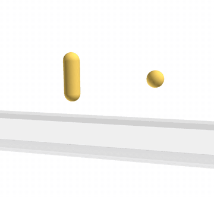</a><br/><code>helloworld</code></td>
<td align="center"><a href="helloworldPlus"></a><br/><code>helloworldPlus</code></td>
<td align="center"><a href="driving">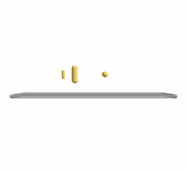</a><br/><code>driving</code></td>
<td align="center"><a href="isoComprSpheres">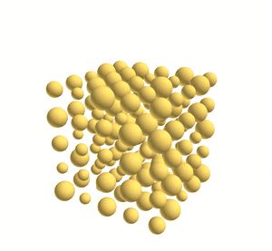</a><br/><code>isoComprSpheres</code></td>
</tr>
<tr>
<td align="center"><a href="prepro_cpptools">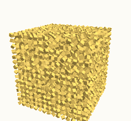</a><br/><code>prepro_cpptools</code></td>
<td align="center"><a href="DominoFun">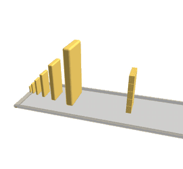</a><br/><code>DominoFun</code></td>
<td align="center"><a href="stickVerticesInClusters">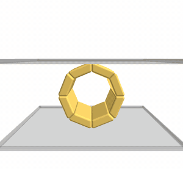</a><br/><code>stickVerticesInClusters</code></td>
<td align="center"><a href="isoComprSpheresPeriodic">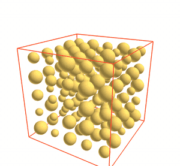</a><br/><code>isoComprSpheresPeriodic</code></td>
</tr>
<tr>
<td align="center"><a href="PerioPoly">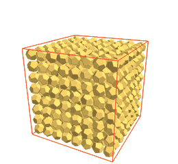</a><br/><code>PerioPoly</code></td>
<td align="center"><a href="softParticles/softBallImpact">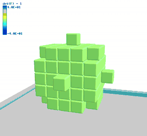</a><br/><code>softBallImpact</code></td>
<td align="center"><a href="softParticles/softBallImpactVoronoi">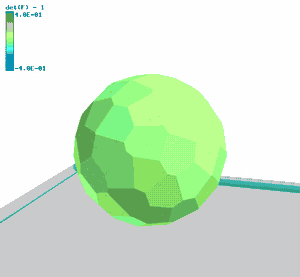</a><br/><code>softBallImpactVoronoi</code></td>
<td align="center"><a href="softParticles/bondedBeam">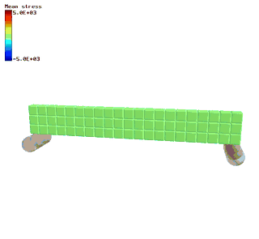</a><br/><code>bondedBeam</code></td>
</tr>
<tr>
<td align="center"><a href="softParticles/elasticCube">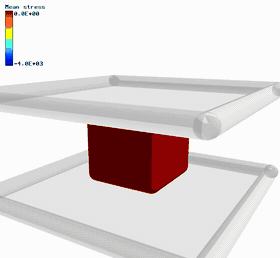</a><br/><code>elasticCube</code></td>
<td align="center"><a href="softParticles/viscousCube">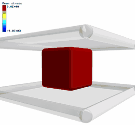</a><br/><code>viscousCube</code></td>
<td align="center"><a href="sweepable">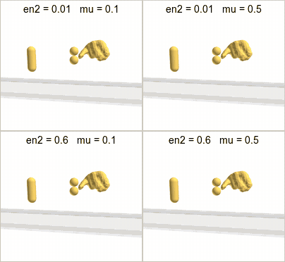</a><br/><code>sweepable</code></td>
<td align="center"><a href="complexShape"></a><br/><code>complexShape</code></td>
</tr>
<tr>
<td align="center"><a href="postProcessing">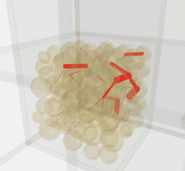</a><br/><code>postProcessing</code></td>
<td align="center"><a href="triaxialTest">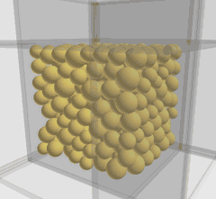</a><br/><code>triaxialTest</code></td>
<td align="center"><a href="fragmentation">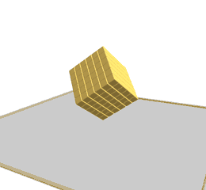</a><br/><code>fragmentation</code></td>
<td align="center"><a href="columnCollapse">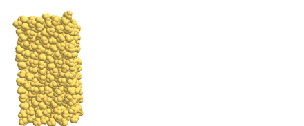</a><br/><code>columnCollapse</code></td>
</tr>
<tr>
<td colspan="4" align="center"><a href="rockfall">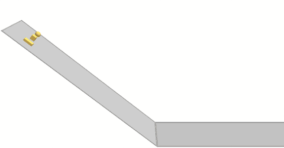</a><br/><code>rockfall</code></td>
</tr>
<tr>
<td align="center"><a href="bunnyFun/bunnyPile">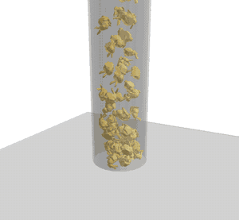</a><br/><code>bunnyFun/bunnyPile</code></td>
<td align="center"><a href="bunnyFun/bunnyInBunny">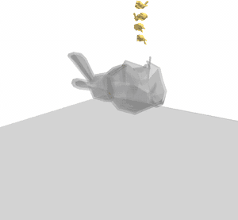</a><br/><code>bunnyFun/bunnyInBunny</code></td>
<td align="center"><a href="bunnyFun/bunnyShot">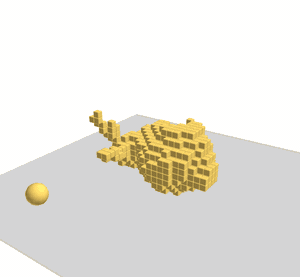</a><br/><code>bunnyFun/bunnyShot</code></td>
<td align="center"><a href="bunnyFun/jellyBunny">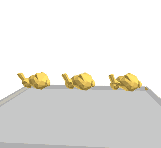</a><br/><code>bunnyFun/jellyBunny</code></td>
</tr>
<tr>
<td align="center"><a href="bunnyFun/voronoiBunny">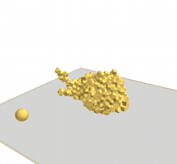</a><br/><code>bunnyFun/voronoiBunny</code></td>
<td align="center"><a href="bunnyFun/bunnyBlocks">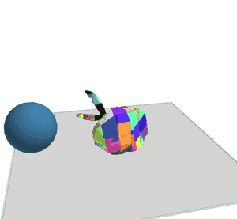</a><br/><code>bunnyFun/bunnyBlocks</code></td>
<td></td>
<td></td>
</tr>
</table>


## Before starting

Build and install Rockable from the root of the repository, then make the
executables reachable from the shell:

```sh
sh install_rockable.sh
source add_install_to_path.sh
```

The examples then use the commands `rockable` (the computation), `see` (the
viewer), and, for some of them, `generator`, `shapeSurvey`, `stl2shape`,
`postpro` or `sweepable`.

**Edit the input files with `rockedit`.** It is an editor that runs in the
terminal, installed with Rockable. It colours the keywords and, above all,
**documents them**: put the cursor on a keyword (`tmax`, `knContact`,
`Control`...) and press `Ctrl+D` to read what it does and what it expects.
`Ctrl+P` inserts ready-made blocks, `Ctrl+O` saves, `Ctrl+X` quits.

```sh
rockedit input.txt
```

`confedit` is its graphical counterpart (see the page
[editors](https://richefeu.github.io/rockable/editors.html) of the
documentation).

The scripts of the examples only use the shell and `awk`, and the plots
`gnuplot`.

An example can be run directly in its folder:

```sh
cd examples/helloworld
rockable input.txt
see conf10
rockable -c          # deletes the results of the computation
```

The files written by a computation (`conf0`, `conf1`, ..., `kineticEnergy.txt`,
`perf.txt`, ...) are ignored by git (see `examples/.gitignore`), so they cannot
be committed by mistake. `rockable -c` deletes them, except the files written
by the data extractors and `extractedDataDoc.txt`, which have to be deleted by
hand. To keep the folder of the
repository clean during a training day, the folder can also be copied first:
`cp -r examples/helloworld ~/tuto/`.


## Learning path

| #  | Folder                                                 | What it teaches                                                                 | Time    |
|----|--------------------------------------------------------|---------------------------------------------------------------------------------|---------|
| 1  | [`helloworld`](helloworld)                             | The input file, the shape file, running a computation, looking at it with `see` | < 1 s   |
| 1b | [`helloworldPlus`](helloworldPlus)                     | A shape from an STL mesh, the homothety, a spring joint, an expression          | 4 s     |
| 2  | [`driving`](driving)                                   | Driving a body with `drivingSystem.txt`                                          | 1 s     |
| 3  | [`isoComprSpheres`](isoComprSpheres)                   | Preparing a sample: a box of walls, a servo-controlled isotropic compression     | 20 s    |
| 3b | [`postProcessing`](postProcessing)                     | After the computation: `postpro` (SampleState), the conf-files, ParaView         | 8 s     |
| 3c | [`triaxialTest`](triaxialTest)                         | A triaxial test: restarting from a conf-file, peak, dilatancy, critical state  | 40 s    |
| 4  | [`prepro_cpptools`](prepro_cpptools)                   | Generating shapes and packings with `generator`                                  | 15 min  |
| 5  | [`DominoFun`](DominoFun)                               | A complete system built with `generator`                                         | 5 min (4 threads) |
| 6  | [`stickVerticesInClusters`](stickVerticesInClusters)   | Breakable bonds: clusters, the `StickedLinks` law                                | 2 s     |
| 7  | [`isoComprSpheresPeriodic`](isoComprSpheresPeriodic)   | Periodic boundary conditions                                                     | 6 s     |
| 8  | [`PerioPoly`](PerioPoly)                               | A periodic sample of polyhedra: isotropic compression of the cell              | 4 min   |
| 9  | [`softParticles`](softParticles)                       | Deformable particles (DCEM), bonded cells (`BCM`)                                | 1-5 s   |
| 10 | [`sweepable`](sweepable)                               | Parametric studies: many computations from one script                            | 10 s    |
| 11 | [`complexShape`](complexShape)                         | From an STL mesh to a shape: `stl2shape`, `shapeSurvey`                          | 20 s    |
| 12 | [`rockfall`](rockfall)                               | A rockfall: a slope, the `Avalanche` law, run-out and `TrackRockfall`            | < 1 s   |
| 13 | [`fragmentation`](fragmentation)                     | Fragmentation: bonded cells (`BCM`), fracture energy, damage, fragments         | 7 s     |
| 14 | [`columnCollapse`](columnCollapse)                   | Collapse of a granular column: a gate lifted by the servo `ramp`, run-out, `GeoVisc` | 70 s    |
| 15 | [`bunnyFun/bunnyPile`](bunnyFun/bunnyPile)          | The Stanford bunny: STL to shape, packing any shape with `generatePacking:OBBs`, stabilising a packing | 1 min (4 threads) |
| 16 | [`bunnyFun/bunnyInBunny`](bunnyFun/bunnyInBunny)    | Bunnies in a bunny: a shape edited into a shell (`isSurface`), a driven rotation  | 1.5 min (4 threads) |
| 17 | [`bunnyFun/bunnyShot`](bunnyFun/bunnyShot)          | A shot in the head: a shape cut into bonded cells (`grid_clust_inside`), fragments | 45 s (4 threads) |
| 18 | [`bunnyFun/jellyBunny`](bunnyFun/jellyBunny)        | Jelly bunnies: soft particles (DCEM) on a mesh, their stability and viscosity  | < 1 s   |
| 19 | [`bunnyFun/voronoiBunny`](bunnyFun/voronoiBunny)    | A Voronoi bunny: Neper and `tess2shape` (**needs Neper**), the time step of bonded cells | 6 min (4 threads) |
| 20 | [`bunnyFun/bunnyBlocks`](bunnyFun/bunnyBlocks)      | A bunny in blocks: `stl2blocks`, a tree of plane cuts, a rolling cannonball, fragments by volume | 2 min (4 threads) |

The times are those of the whole computation on a laptop, with one thread
unless stated otherwise.


## How each example is documented

The `readme.md` of each tutorial follows the same plan:

1. **Goal** - what the example shows, in two or three lines.
2. **Notions** - the keywords and tools it introduces, with links to the
   documentation.
3. **Files** - what each file of the folder is for.
4. **Run it** - the commands, and how long it takes.
5. **What happens** - the physics of the computation.
6. **What to look at** - in `see`, in the output files, with the expected
   values when there are some.
7. **Exercises** - small changes to try, for a training day.
8. **Going further** - pointers to the documentation and to other examples.

A new example should follow the same plan, and be added to the tables above.
