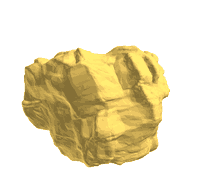

## 11. From an STL mesh to a shape

<p align="center"><br/>
<em>The spinning rock in <code>see</code>: drawn with spheres, tubes and slabs (left), and with its skin mesh <code>rock.rmsh</code> (right).</em></p>

### Goal

A rock scanned as a triangulated mesh (`rock.stl`) is converted into a
Rockable shape with `stl2shape`, checked and pre-computed with `shapeSurvey`,
then used in a computation: the rock spins freely in space. Finally, a
watertight skin mesh of the shape is made with `shape2mesh`, for a smooth and
fast drawing in `see`.

### Notions

- The converter **`stl2shape`** and its Minkowski radius
  ([converters](https://richefeu.github.io/rockable/converters.html)).
- The **pre-computation** of a shape (`preCompDone`, volume, inertia), and the
  application **`shapeSurvey`**
  ([shapeSurvey](https://richefeu.github.io/rockable/shapeSurvey.html)).
- The **homothety**, to change the unit of a shape.
- A library of shapes made of several files put together.
- The **skin mesh** of a shape (`shape2mesh`, the `.rmsh` companion file)
  ([converters](https://richefeu.github.io/rockable/converters.html)).

### Files

| File          | Content                                                                 |
|---------------|-------------------------------------------------------------------------|
| `rock.stl`    | A scanned rock: a binary STL mesh of 24 236 triangles, in millimetres    |
| `cubo5mm.stl` | A cubic frame (a non-convex shape), in millimetres                       |
| `input.txt`   | The conf-file: the rock, spinning                                        |

### Run it

```sh
stl2shape -r 0.5 -c rock.stl     # writes mesh.shp
mv mesh.shp rock.shp
shapeSurvey rock.shp             # look at it (q to quit)
shapeSurvey rock.shp -P rock.shp # pre-computation, about 20 seconds
rockable input.txt               # less than 1 second
shape2mesh rock.shp --rmsh       # writes rock.rmsh, the skin mesh
see
```

### What happens

**The conversion.** `stl2shape` takes the mesh as the skeleton of a
sphero-polyhedron: its vertices, edges and triangles become those of the
shape, and the whole is dilated by the Minkowski radius given with `-r` (here
0.5, in the unit of the mesh: 0.5 mm). `-c` removes the duplicated edges: an
STL file stores each triangle on its own, so that every edge appears twice
(14 867 of the 51 214 edges are removed here). The shape is written in
`mesh.shp`, and is named after the STL file:

```
<
name rock.stl
radius 0.5
preCompDone n
...
nv 12113
```

`stl2shape` always writes `mesh.shp`, hence the `mv`, before converting
another mesh.

**The pre-computation.** `preCompDone n` means that the volume, the position
of the mass centre, the inertia and the principal axes of the shape are not
known yet. Rockable computes them when the computation starts (by a
Monte-Carlo integration), and prints them:

```
Computation of mass properties (volume, mass-center, inertia and body-frame) for shape rock.stl
                                        Volume: 42878.3
                                  inertia/mass: 179.796 215.449 210.393
```

For this rock, it takes about 20 seconds, at each start. `shapeSurvey rock.shp
-P rock.shp` does it once and for all: it computes the mass properties, writes
them in `rock.shp` with `preCompDone y`, and exits, without opening a window.
The next computations start at once. In the window of `shapeSurvey rock.shp`,
the keys `C` then `s` do the same, but write the result in `mod_rock.shp`.

**The units.** The mesh is in millimetres: the volume is 42 878 mm³, about
43 cm³. In `input.txt`, the particle has a homothety of `1.0e-3`, which turns
the millimetres into metres; the radius, the mass and the inertia follow. With
a density of 2700 kg/m³, the rock weighs about 116 g.

**The computation.** There is no gravity and no other body. The rock is given
an angular velocity `(1, 6, 0.5)` rad/s, and spins freely for one second. Its
angular momentum is kept, but not its angular velocity: the components of
`vrot` in the conf-files vary along the rotation, because the inertia of the
rock is not the same about all its axes.

**The skin.** `see` normally draws a shape as it is made: a sphere at each
vertex, a tube along each edge and a slab on each face, all of the Minkowski
radius. For this rock, 12 113 spheres, 36 347 tubes and 24 236 slabs per
frame: slow, and the facets of the scan show. `shape2mesh rock.shp --rmsh`
meshes the exact surface of the rounded shape (the skeleton dilated by the
radius) into a closed, watertight mesh of 16 204 triangles with exact normals,
and writes it in `rock.rmsh`. When a `.rmsh` file with the same stem as the
shape file (`rock.shp` and `rock.rmsh`) is next to it, `see` loads it
(`Loaded 1 skin mesh(es) from rock.rmsh`) and draws each particle with its
skin: the drawing is smooth, and about six times faster here. The skin is
only a drawing: the computation does not use it.

The mesh is built in the body frame of the shape (its mass centre and its
principal axes). If the shape is still marked `preCompDone n`, `shape2mesh`
pre-computes it first, which takes 20 seconds more each time.

### What to look at

- In `see`, the rock and its rotation, with its skin. Rename `rock.rmsh` and
  open `see` again to compare with the drawing by spheres, tubes and slabs.
- The line of the rock in the conf-files: `Q` (the orientation) and `vrot`.
- The cost of a shape grows with its number of vertices, edges and faces. A
  mesh of 12 000 vertices is fine for one particle, much too heavy for a
  sample of thousands: decimate the mesh before converting it.

### Exercises

1. Convert the rock with a larger radius, `stl2shape -r 2 -c rock.stl`, and
   compare the two shapes in `shapeSurvey`: the details are smoothed, and the
   volume is larger.
2. Convert `cubo5mm.stl`, a cubic frame of 120 mm made of bars of 5 mm. The
   shape is not convex: a grain could go through it.
3. Let the rock fall on a plane. Put the shape `Plan` of
   [`helloworld`](../helloworld) and the rock in a single library:

   ```sh
   awk '/^</{b=$0; k=0; next} /^name Plan/{k=1; print b} k{print} /^>/{k=0}' ../helloworld/shapes.shp > plan.shp
   cat rock.shp plan.shp > shapes.shp
   ```

   then, in a copy of `input.txt`: `shapeFile shapes.shp`, `gravity 0 -9.81 0`,
   `dt 1e-5`, `interVerlet 0.001`, `nDriven 1`, `density 1 2700`, the contact
   parameters of the pair of groups `0 1` (`knContact 0 1 1e4`,
   `en2Contact 0 1 0.1`, `ktContact 0 1 1e4`, `muContact 0 1 0.5`, and `0` for
   `krContact` and `murContact`), and the two particles:

   ```
   Particles 2
   Plan     0 0 0.1      0 0 0     0 0 0   0 0 0   1 0 0 0   0 0 0   0 0 0
   rock.stl 1 0 1.0e-3   0 0.1 0   0 0 0   0 0 0   1 0 0 0   1.0 6.0 0.5   0 0 0
   ```

   The plane is scaled down to 40 × 10 cm. The rock lands at `t = 0.1 s`, and
   is at rest from about `t = 0.6 s`. For the skins, run
   `shape2mesh shapes.shp --rmsh` on the new library: it writes `shapes.rmsh`,
   with the skins of the two shapes.
4. Export the skin for another program (ParaView, Blender, a 3D printer):
   `shape2mesh rock.shp -e 0.05` writes `rock.obj`, with a sag (the largest
   distance between the mesh and the exact surface) of 0.05 mm: 104 684
   triangles, and a volume of 42 863 mm³, close to the 42 878 mm³ of the
   Monte-Carlo integration. Without `-e`, the sag is 1 % of the radius, and
   the file is seven times larger.

### Going further

- [`helloworldPlus`](../helloworldPlus): a converted shape in a small system.
- The options of `stl2shape` (`-s`, `-m`, `-z`) and the other converters:
  [converters](https://richefeu.github.io/rockable/converters.html).
- The format of the shapes:
  [syntaxShapes](https://richefeu.github.io/rockable/syntaxShapes.html).
