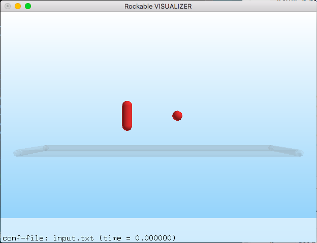

## 1. Hello world: a first simulation

<p align="center"></p>

### Goal

Two grains, a sphere and an elongated grain, fall on a fixed plane and come to
rest. This is the smallest complete simulation: it shows the two files that
every computation needs, how to run it, and how to look at the result.



### Notions

- The **conf-file** (`input.txt`), which holds the whole system: time
  parameters, interaction parameters and the list of particles
  ([syntaxConf](https://richefeu.github.io/rockable/syntaxConf.html)).
- The **shape file** (`shapes.shp`), which defines the sphero-polyhedra
  ([syntaxShapes](https://richefeu.github.io/rockable/syntaxShapes.html)).
- **Groups**, which select the interaction parameters, and **driven** bodies
  (`nDriven`).
- The commands `rockable` and `see`.

### Files

| File          | Content                                                                         |
|---------------|---------------------------------------------------------------------------------|
| `input.txt`   | The conf-file: the system at the initial time, and all the parameters          |
| `shapes.shp`  | The library of shapes: `Plan`, `Sphere` and `Rice` (a sphero-segment)          |
| `see_input.png` | What `see input.txt` shows                                                    |

### Run it

```sh
rockedit input.txt   # read the input file; Ctrl+D documents the keyword under the cursor
see input.txt        # look at the system before running it
rockable input.txt   # less than a second
see                  # look at the results (conf0 by default)
```

The computation writes 21 conf-files, `conf0` (t = 0) to `conf20`
(t = 1 s), plus `kineticEnergy.txt`, `perf.txt`, `staticBalance.txt` and
`checkplots.txt`. `rockable -c` deletes them.

### What happens

Let us read `input.txt` from top to bottom. Open it with `rockedit input.txt`:
on any keyword, `Ctrl+D` shows its documentation, which is a good way to
follow the explanations below and to discover the other keywords.

```
Rockable 21-08-2022
```

Every conf-file starts with this header; the date is the version of the format.

```
t 0
tmax 1.0
dt 1e-6
interVerlet 0.01
interConf 0.05
```

The computation goes from `t = 0` to `tmax = 1 s` with a time step `dt` of
1 microsecond. The list of neighbours is rebuilt every `interVerlet = 0.01 s`,
and a conf-file is saved every `interConf = 0.05 s`.

```
DVerlet 0.08
dVerlet 0.02
```

Two bodies are neighbours when their bounding boxes, enlarged by `DVerlet`,
overlap; two parts of them (vertices, edges, faces) are then followed when they
are closer than `dVerlet`. These distances must be larger than the distance a
body travels between two rebuilds of the list.

```
density 0 2700
density 1 2700
```

The density of the bodies of group 0 and of group 1, in kg/m³. The mass and
the inertia of a particle are computed from it and from its shape.

```
forceLaw Default
knContact 0 1 1e7
en2Contact 0 1 0.02
...
```

The force law, and its parameters for each **pair of groups**: `0 1` is the
plane (group 0) against a grain (group 1), `1 1` a grain against a grain. A
contact has a normal stiffness `knContact`, a tangential stiffness
`ktContact`, a friction coefficient `muContact`, and a restitution coefficient
whose square is `en2Contact` (0.02 against the plane, 0.2 between grains).

```
nDriven 1
shapeFile shapes.shp
Particles 3
Plan   0 0 1.0   0 -0.05 0   0 0 0   0 0 0   1 0 0 0         0 0 0     0 0 0
Rice   1 0 1.0  -0.5 0.5 0   0 0 0   0 0 0   0.707 0 0.707 0   0 0 -10   0 0 0
Sphere 1 0 1.0   0.3 0.5 0   0 0 0   0 0 0   1 0 0 0         0 0 0     0 0 0
```

The first `nDriven = 1` particle, the plane, is **driven**: it does not move,
since nothing else is said about it (see the example `driving`). Each
particle line gives the shape name, the group, the cluster, the homothety
(a size factor), then the position, the velocity, the acceleration, the
orientation (a quaternion), the angular velocity and the angular acceleration.
The gravity is `0 -9.81 0` by default, so `y` is the vertical.

The two grains fall from a height of 0.5 m. The elongated grain touches the
plane first by one end, at about t = 0.24 s, tips over and ends lying on the
plane. The sphere bounces a few times. From t = 0.7 s on, everything is at
rest.

### What to look at

- In `see`, the keys `+` and `-` go from one conf-file to the next, and `k`
  lists all the keys, `h` the use of the mouse: the left button rotates the
  view, `Shift` + left button moves it, `Ctrl` + left button (or the middle
  button) zooms. The right button opens a menu.
- At the end (`conf20`), both grains lie on the plane at `y = 0.08`, which is
  their Minkowski radius: the top of the plane is at `y = 0`. There are 4
  contacts (`Interactions 4` in `conf20`).
- `gnuplot checkplots.txt` plots the kinetic energy, which drops to zero.

### Exercises

1. Set `en2Contact 0 1` to `0.8`: the grains bounce much more. How long does
   the sphere take to come to rest?
2. Set `muContact 0 1` to `0`: what does the elongated grain do once it lies
   on the plane?
3. Remove the initial angular velocity of the `Rice` (`0 0 -10` → `0 0 0`).
   Does it still fall on its side?
4. Add a second sphere above the first one, at `0.3 0.8 0`, and do not forget
   to update the number of particles (`Particles 4`). Use `rockedit`: `Ctrl+D`
   on `Particles` recalls the meaning of each column.
5. Follow the height of the sphere during the fall: create a file
   `dataExtractors.txt` containing the line `TrackBody 2 sphere.txt 1000`, run
   the computation again, and plot the third column of `sphere.txt` against the
   first one (see [dataExtractors](https://richefeu.github.io/rockable/dataExtractors.html)).

### Going further

- [`helloworldPlus`](../helloworldPlus): a complex shape from an STL file, a
  spring between two spheres, and a few other options of the conf-file.
- [`driving`](../driving): moving the driven bodies.
- The quick start of the documentation:
  [quickStart](https://richefeu.github.io/rockable/quickStart.html).
