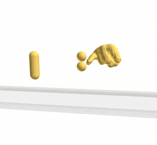

## 1b. Hello world, continued: more of the conf-file

<p align="center"></p>

### Goal

The system of [`helloworld`](../helloworld), with two more grains and a few
more features of the conf-file: a rock whose shape comes from an STL mesh, two
spheres held together by a spring, and a time step written as an expression.
Read `helloworld` first.

### Notions

- A **complex shape** (a polyhedron of 1381 vertices), scaled with the
  **homothety** of the particle.
- A **spring joint** between two bodies (`initSpringJoint`).
- An **arithmetic expression** in the conf-file.
- Options that change the dynamics: the velocity barriers, the number of
  threads.

### Files

| File         | Content                                                                    |
|--------------|----------------------------------------------------------------------------|
| `input.txt`  | The conf-file                                                              |
| `shapes.shp` | The shapes of `helloworld`, plus `HandRockSimple.stl`, converted from an STL mesh |

### Run it

```sh
rockable input.txt   # about 4 seconds
see
```

### What happens

The beginning of `input.txt` is that of `helloworld`. The differences are:

```
dt $2 * 0.5e-6$
```

The time step is given as an expression between `$`, which is evaluated when
the file is read (here, `1e-6`). Only `dt` accepts an expression.

```
interVerlet 0.001
```

The list of neighbours is rebuilt ten times more often than in `helloworld`.
Between two rebuilds, no point of a body may travel more than `dVerlet`
(2 cm here), and the velocity to consider is that of the fastest vertex, the
rotation included: the tips of the elongated grain and of the rock move much
faster than their centres. With `interVerlet 0.01`, a tip can cross `dVerlet`
before the list is rebuilt, and the contact is only found when the two bodies
already overlap by several millimetres: the huge repulsive force then creates
energy, and a grain can be thrown up at more than 10 m/s (see the exercises of
[`sweepable`](../sweepable)).

```
Sphere             1 0 1.0      0.3 0.5 0   0 0 0     0 0 0   ...
Sphere             1 0 1.0      0.3 0.66 0  0.5 0 0   0 0 0   ...
HandRockSimple.stl 1 0 1.0e-2   0.7 0.7 0   0.5 0 0   0 0 0   ...
```

A second sphere sits on top of the first one, and is launched sideways at
0.5 m/s. The rock `HandRockSimple.stl` is a shape converted from an STL mesh
with `stl2shape` (see [`complexShape`](../complexShape)). Its coordinates in
`shapes.shp` are those of the mesh, about 100 units long, so the particle uses
a **homothety** of `1.0e-2` to bring it to a size of about 1 m. The homothety scales the
whole shape, the Minkowski radius included, and the mass and inertia follow.

```
initSpringJoint  2  0 0.08 0     3  0 -0.08 0    1e6
```

A linear spring of stiffness `1e6` N/m links a point of body 2 (the first
sphere) to a point of body 3 (the second sphere). The points are given in the
frame of each body, here the top of the first sphere and the bottom of the
second one, which coincide at the start: the spring has a zero length at rest
and keeps the two spheres together. Unlike a bond, a spring never breaks.

The rock and the pair of spheres fall, collide and roll on the plane. At
`t = 1 s`, the elongated grain and the rock are at rest, while the two spheres
still roll.

### What to look at

- In `see`, the rock is drawn with all its facets. A smoother and faster
  drawing is obtained with a skin mesh:
  `shape2mesh shapes.shp --rmsh` writes `shapes.rmsh`, which `see` uses
  automatically.
- The two spheres keep in contact while they swing, held by the spring.

> **Note.** The springs are written in the conf-files, in the section
> `SpringJoints`, with their length at rest: a computation restarted from a
> conf-file (`rockable conf10`) keeps them. Do not add an `initSpringJoint`
> line to a conf-file to restart: it would take the current, stretched length
> as the length at rest.

### Exercises

1. Change the stiffness of the spring to `1e3`: the two spheres separate
   further while they swing.
2. Change the homothety of the rock to `2.0e-2`: it is twice as large, and
   eight times heavier.
3. Add the line `VelocityBarrier 0.5` after `forceLaw Default`: the velocity
   components are now held below about 0.5 m/s (see
   [dissipation](https://richefeu.github.io/rockable/dissipation.html)). Look at
   the fall of the grains.
4. Run the computation with 4 threads, `rockable input.txt -j 4`, and compare
   the time. With so few particles, it is slower: the threads only pay off
   for large samples.

### Going further

- [`complexShape`](../complexShape): converting an STL mesh into a shape.
- [`driving`](../driving): moving the driven bodies.
- The keywords of the conf-file:
  [syntaxConf](https://richefeu.github.io/rockable/syntaxConf.html).
